<picture>
  <source media="(prefers-color-scheme: dark)" srcset="./assets/bento-dark.svg" />
  
</picture>

  <a href="https://github.com/jfeulner95/claude-cheat-sheet"><picture>
    <source media="(prefers-color-scheme: dark)" srcset="./assets/project-claude-cheat-sheet-dark.svg" />
    
  </picture></a>
  <a href="https://github.com/jfeulner95/git-cheat-sheet"><picture>
    <source media="(prefers-color-scheme: dark)" srcset="./assets/project-git-cheat-sheet-dark.svg" />
    
  </picture></a>

  <a href="https://github.com/jfeulner95/ClaudeCodeSkillSummary"><picture>
    <source media="(prefers-color-scheme: dark)" srcset="./assets/project-ClaudeCodeSkillSummary-dark.svg" />
    
  </picture></a>
  <a href="https://github.com/jfeulner95/jfeulner95"><picture>
    <source media="(prefers-color-scheme: dark)" srcset="./assets/project-jfeulner95-dark.svg" />
    
  </picture></a>

